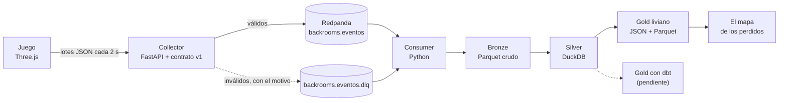

# backrooms-streaming-redpanda

**Un Backrooms jugable en el navegador donde La Interferencia no te ve: te oye. Cada paso, cada persecución y cada
captura es un evento real que viaja por un pipeline de streaming hasta un mapa de dónde se pierde la gente. Con esos
datos se ajustó el juego: la captura bajó de 100 % a 0 % entre dos versiones.**

<p align="center"></p>

Proyecto del portfolio de Data Engineering de Gastón. Código, documentación y commits en español.

- **Jugarlo:** https://lost-in-the-pipeline.vercel.app (sin telemetría, ver [Límites](#límites-y-lo-que-haría-en-un-caso-real))
- **Video (3 min):** https://www.youtube.com/watch?v=ChZ3_jd4N_c

[](https://www.youtube.com/watch?v=ChZ3_jd4N_c)

## El problema
Un juego genera eventos sin parar, desde un navegador que se puede cerrar en cualquier momento, con una red que se
cae y un cliente que cambia de versión. Hay que llevarlos a un lugar donde se puedan consultar, sin perderlos, sin
contarlos dos veces y sin guardar nada de quien juega. Y después usarlos para algo: acá, decidir si La Interferencia
es demasiado letal y mostrar en un mapa dónde se pierde la gente.

El mundo no se guarda: es una función de la `seed` y las coordenadas (el generador es un port del de
[TediusTimmy/BackRooms](https://github.com/TediusTimmy/BackRooms)). Por eso, con los eventos alcanza para reconstruir
el mapa de cualquier partida.

## Arquitectura



El juego encola los eventos en `localStorage` y los manda en lotes al collector, que valida cada uno contra
[`contracts/event.schema.json`](contracts/event.schema.json): los válidos van a `backrooms.eventos` (key = sesión) y
los inválidos a la DLQ con el motivo. El consumer escribe Bronze crudo en Parquet, arma Silver en DuckDB (sesiones y
persecuciones con duración y resultado) y exporta un Gold liviano que lee el mapa. Detalle en
[docs/TECNICO.md](docs/TECNICO.md#cómo-viajan-los-eventos).

## Qué demuestra
- **Datos que cambiaron una decisión.** Con las primeras partidas (cliente 0.4.0), La Interferencia ganaba siempre:
  arrancaba la cacería a 6 m y atrapaba en segundos. En 0.5.0 la cacería no arranca a menos de 10 m (así el titileo
  de las luces avisa antes) y la entidad cazando baja de 2,9 a 2,6 m/s, contra 3,4 m/s del jugador corriendo:

  | Cliente | Sesiones | Persecuciones | Capturas | Escapes | % de captura | Distancia inicial media | Persecución media |
  |---|---:|---:|---:|---:|---:|---:|---:|
  | 0.4.0 | 4 | 2 | 2 | 0 | 100 % | 6,0 m | 3,7 s |
  | 0.5.0 | 6 | 2 | 0 | 2 | 0 % | 10,9 m | 17,8 s |

  Los dos escapes de 0.5.0 fueron uno por noclip a los 5,5 s y otro por retirada de la entidad a los 30 s. Son dos
  persecuciones por versión: alcanza para ver la tendencia, no para cantar victoria. Además, una captura de 0.5.0 que
  se ve en la grabación nunca llegó al pipeline (ver [Límites](#límites-y-lo-que-haría-en-un-caso-real)), así que el
  0 % puede estar subestimado.
- **Un contrato que se prueba de los dos lados.** El schema es la fuente de verdad: los tests del juego
  ([`game/contract.test.ts`](game/contract.test.ts)) y los del collector ([`collector/test_app.py`](collector/test_app.py))
  validan los mismos ejemplos de [`contracts/examples/`](contracts/examples/). Un campo de más o con otro tipo va a la
  DLQ con el motivo, no se pierde en silencio.
- **Entrega at-least-once de punta a punta.** Si el collector no responde, el lote queda en la cola con espera
  creciente (2 a 30 s) y sobrevive a cerrar la pestaña; al salir se manda con `sendBeacon`. Aguas abajo se deduplica
  por `event_id` ([`game/outbox.ts`](game/outbox.ts), [`consumer/silver.sql`](consumer/silver.sql)).
- **El mismo generador en el juego y en el mapa.** `world/` es un módulo puro, sin DOM ni Three, con la `seed` en el
  hash y versionado con `world_v`: misma seed, mismo mundo, en el juego y en el dashboard.
- **Privacidad por diseño.** IDs de sesión anónimos, sin IP ni datos personales, y en el deploy público la telemetría
  está apagada hasta que haya un collector preparado.
- **77 tests locales**: 61 en TypeScript (generador, entidad, outbox, contrato, mapa) y 16 en Python (collector y
  pipeline).

### El mapa de los perdidos


Elegís seed, nivel y capa; el laberinto se reconstruye en el navegador con el mismo generador del juego y encima van
el heatmap de rastros, las capturas (✕), los escapes (▲) y los noclips (◆), con contadores y el % de captura por
versión. Lee solo el Gold que exporta el consumer.

## Decisiones y lo que aprendí
- **No guardar el mundo.** Guardar el laberinto de cada partida era inviable (es infinito y cambia). Con `seed` +
  `world_v` en cada evento, el mapa lo regenera; si los datos son de otro `world_v`, el mapa avisa en vez de dibujar
  paredes equivocadas.
- **Gold antes que dbt.** Para tener el mapa a tiempo (F5), el consumer exporta un Gold liviano en JSON y Parquet;
  el Gold con dbt y sus tests (F4) quedó para después, con el contrato ya estable.
- **Datos reales siempre.** Ni el mapa ni el video tienen eventos inventados: en el pipeline animado del video la DLQ
  no tiene tráfico porque la de verdad está vacía, y la captura que se perdió se cuenta en vez de taparla.
- **Lo que no se ve en los datos también es un dato.** La sesión `b8a47ebd` dejó de mandar eventos a mitad de
  partida: la grabación muestra una captura que nunca llegó. Nada en la DLQ, lag del consumer en 0 y la cola del
  navegador vacía; la causa sigue abierta y bloquea la telemetría pública.
- **Telemetría apagada por defecto.** Un build sin `VITE_COLLECTOR_URL` no manda eventos a ningún lado; en desarrollo
  usa el proxy de Vite. Así el juego se puede publicar antes que la ingesta.
- **Las sesiones `debug` se filtran en Silver**, no en el juego: Bronze guarda todo lo que llegó y Silver decide qué
  cuenta.
- **Un secreto que no se tiene que servir.** Remotion Studio carga el `.env` del video, donde está la key de
  ElevenLabs, y lo puede exponer a la página. Ahora lee `remotion.env`, sin secretos, y se verificó que ni la página
  ni el bundle la contienen.
- **Entidad propia, licencias primero.** Nada de IP de terceros; lo portado conserva sus avisos y cada pieza
  reutilizada está en [docs/ATRIBUCIONES.md](docs/ATRIBUCIONES.md). El análisis de los repos de partida está en
  [docs/RELEVAMIENTO.md](docs/RELEVAMIENTO.md).

## Límites y lo que haría en un caso real
- **Muestra chica.** Los resultados salen de 10 sesiones locales de prueba y 4 persecuciones.
- **Telemetría apagada en el deploy público** hasta que haya un collector público (ver los pendientes).
- **El laberinto del mapa es el generado, no el jugado.** Los bloques que cambian durante la partida
  (`laberinto_cambio`) no se reflejan, así que un rastro puede cruzar una pared que en ese momento no estaba.
- **Los rastros se interpolan.** Entre un evento y el siguiente pasan unos 2 s y el tramo se rellena en línea recta:
  en las esquinas corta camino y atraviesa paredes. Los saltos de 30 celdas o más (puertas, noclip, una pestaña
  dormida) no se unen.
- **Solo el generador actual.** Si los datos son de otro `world_v`, el mapa muestra los rastros sin paredes y un aviso.
- **El mapa no se actualiza solo.** El consumer rehace el Gold cada 10 s como mucho, pero hay que recargar la página.
- **Contadores por seed, no por capa.** La tabla por versión suma todas las seeds. El % de captura es sobre las
  persecuciones terminadas: las `en_curso` no cuentan, y una captura sin persecución abierta aparece en el mapa pero
  no en el %.
- **El escape por noclip se marca en el nivel de origen**, en la pared por la que se fue.
- **Detalle según el zoom.** Lejos (más de 450.000 celdas en pantalla) no se dibujan las paredes; las de noclip
  aparecen desde 8 px por celda y los pilares del Nivel 1 desde 5 px.
- **Las zonas del mapa se generan en el hilo principal**: al moverse a zonas nuevas puede trabarse un instante.
- **Las sesiones `debug` no aparecen** (se filtran en Silver), y las horas están en UTC.
- **El mapa es solo local**, y el diseño para celu (del juego y del mapa) todavía no se probó en un teléfono.

### Pendientes
- [ ] **La sesión `b8a47ebd` (0.5.0, 29/10).** Bronze tiene sus eventos solo hasta las 16:24:50 UTC; la grabación
  muestra después una persecución y una captura ("TE ENCONTRÓ") que nunca llegaron: ni persecución, ni captura, ni
  `sesion_fin`, nada en la DLQ, y el collector no recibió nada hasta la sesión siguiente. Hay que encontrar la causa
  antes de abrir la telemetría.
- [ ] **Telemetría pública (F6).** Un collector público con CORS para el dominio del juego, límite de tráfico y sin
  guardar IP, y recién ahí `VITE_COLLECTOR_URL` en Vercel.
- [ ] **Gold con dbt (F4)**, post-Halloween: sesiones, supervivencia en persecuciones, zonas más letales y tests de
  contrato con `dbt build`. Hoy el Gold liviano lo exporta el consumer.

El estado fase por fase está en [docs/TECNICO.md](docs/TECNICO.md#estado).

## Stack por capa
| Capa | Tecnología |
|---|---|
| Juego | TypeScript + Vite + Three.js; generador `world/` portado de TediusTimmy/BackRooms |
| Ingesta | Collector FastAPI que valida el contrato de eventos v1 (JSON Schema) |
| Streaming | Redpanda (Kafka API) + Redpanda Console, en Docker |
| Procesamiento | Consumer en Python → Bronze (Parquet) y Silver (DuckDB) |
| Gold | Liviano, exportado por el consumer (JSON + Parquet); dbt-duckdb pendiente (F4) |
| Consumo | "El mapa de los perdidos" (TypeScript + canvas) |
| Deploy | Vercel, sitio estático solo con el juego |
| Video | Remotion + narración con ElevenLabs |

## Estructura del repo
| Carpeta | Qué hay |
|---|---|
| `game/` | El juego: render, jugador, La Interferencia (`entity/`), eventos y la cola de salida |
| `world/` | El generador del mundo, módulo puro y versionado (`world_v`) |
| `contracts/` | El contrato de eventos v1 y ejemplos válidos e inválidos |
| `collector/` | El collector FastAPI y sus tests |
| `consumer/` | Bronze, Silver, Gold liviano, `consulta.py` y tests |
| `dashboard/` | El mapa de los perdidos |
| `video/` | El video, el reel y la miniatura en Remotion ([cómo renderizar](video/README.md)) |
| `third_party/` | Avisos de copyright de lo portado |
| `docs/` | [Detalle técnico](docs/TECNICO.md), [relevamiento](docs/RELEVAMIENTO.md), [atribuciones](docs/ATRIBUCIONES.md) e imágenes |

## Cómo reproducirlo
Con Node 20.19+ o 22.12+ y Docker:
```bash
docker compose up --build -d   # Redpanda, Console, collector y consumer
npm install
npm run dev                    # el juego en http://localhost:5173
```
Los eventos se ven en Redpanda Console (http://localhost:8080) y el mapa se abre con `npm run dash`
(http://localhost:5174). Tests, consultas a DuckDB y el resto, en [docs/TECNICO.md](docs/TECNICO.md).

### Jugarlo online
El juego (solo el juego, sin el mapa) se despliega como sitio estático en Vercel con [`vercel.json`](vercel.json):

1. En Vercel, **Add New → Project** e importar este repo. Vercel toma de `vercel.json` el build (`npm run build`) y
   la salida (`dist/`); no hace falta tocar nada más.
2. **Telemetría**: sin la variable `VITE_COLLECTOR_URL`, el build no manda eventos a ningún lado. Para activarla, en
   **Settings → Environment Variables** definir `VITE_COLLECTOR_URL` con la base de un collector público (el juego le
   pega a `<base>/events`) y volver a desplegar. Antes hace falta todo lo de los [pendientes](#pendientes).
3. Con la CLI: `npx vercel` (vista previa) o `npx vercel --prod`. `.vercelignore` deja afuera datos, video y servicios.

## Costos
| Plataforma | Costo | Detalle |
|---|---|---|
| Redpanda, collector, consumer | **USD 0** | Locales, en Docker |
| Bronze, Silver y Gold | **USD 0** | Parquet y DuckDB en disco, sin warehouse |
| Vercel | **USD 0** | Sitio estático del juego, sin funciones ni base de datos |

## Licencias y atribución
- El código propio va bajo licencia MIT ([LICENSE](LICENSE)).
- El generador del mundo es un port del de [TediusTimmy/BackRooms](https://github.com/TediusTimmy/BackRooms)
  (Thomas DiModica, BSD-3-Clause).
- El oído y el director de La Interferencia parten de [liminal](https://github.com/yerdaulet-damir/liminal) (MIT).
- Lore comunitario de las wikis de Backrooms, bajo CC BY-SA 3.0.

Lo portado conserva sus avisos en [`third_party/`](third_party/) y en la cabecera de cada archivo. Detalle completo,
con qué se tomó de cada uno, en [docs/ATRIBUCIONES.md](docs/ATRIBUCIONES.md).
