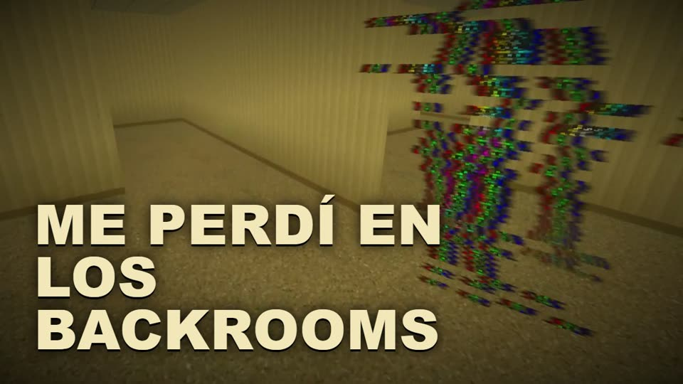
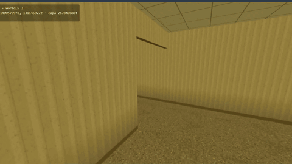
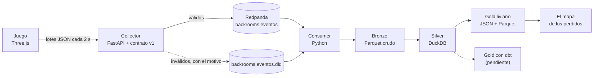
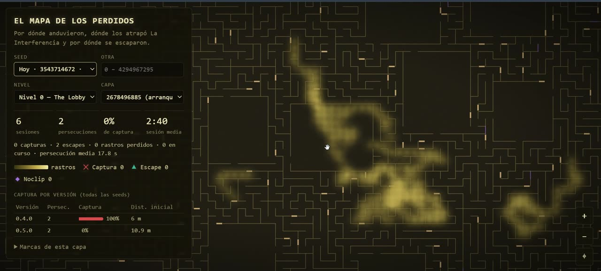

# backrooms-streaming-redpanda



<p align="center"></p>

## Qué es
Un Backrooms jugable en el navegador (TypeScript, Vite y Three.js) donde **La Interferencia** no te ve: te oye.
Cada paso, cada persecución y cada captura es un evento real que viaja por un pipeline de streaming hasta un mapa.
Es un proyecto de portfolio de Data Engineering: el juego genera los datos; Redpanda, Parquet y DuckDB los procesan.

## El pipeline

El mundo no se guarda: es una función de la `seed` y las coordenadas (el generador es un port del de
[TediusTimmy/BackRooms](https://github.com/TediusTimmy/BackRooms)). Por eso, con los eventos alcanza para reconstruir
el mapa de cualquier partida.

## Correrlo
Con Node 20.19+ o 22.12+ y Docker:
```bash
docker compose up --build -d   # Redpanda, Console, collector y consumer
npm install
npm run dev                    # el juego en http://localhost:5173
```
Los eventos se ven en Redpanda Console (http://localhost:8080) y el mapa se abre con `npm run dash`
(http://localhost:5174). Tests, consultas a DuckDB y el resto, en [docs/TECNICO.md](docs/TECNICO.md).

## Resultados: 0.4.0 contra 0.5.0
Con las primeras partidas (cliente 0.4.0), La Interferencia ganaba siempre: arrancaba la cacería a 6 m y atrapaba en
segundos. Con esos datos se ajustó el balance en 0.5.0: la cacería no arranca a menos de 10 m (así el titileo de las
luces avisa antes) y la entidad cazando baja de 2,9 a 2,6 m/s, contra 3,4 m/s del jugador corriendo.

| Cliente | Sesiones | Persecuciones | Capturas | Escapes | % de captura | Distancia inicial media | Persecución media |
|---|---:|---:|---:|---:|---:|---:|---:|
| 0.4.0 | 4 | 2 | 2 | 0 | 100 % | 6,0 m | 3,7 s |
| 0.5.0 | 6 | 2 | 0 | 2 | 0 % | 10,9 m | 17,8 s |

Los dos escapes de 0.5.0 fueron uno por noclip a los 5,5 s y otro por retirada de la entidad a los 30 s. Son dos
persecuciones por versión: alcanza para ver la tendencia, no para cantar victoria. Además, una captura de 0.5.0 que se
ve en la grabación nunca llegó al pipeline (ver [Pendientes](#pendientes)), así que el 0 % puede estar subestimado.

### El mapa de los perdidos


Elegís seed, nivel y capa; el laberinto se reconstruye en el navegador con el mismo generador del juego y encima van
el heatmap de rastros, las capturas (✕), los escapes (▲) y los noclips (◆), con contadores y el % de captura por
versión. Lee solo el Gold que exporta el consumer.

## Jugarlo online
El juego (solo el juego, sin el mapa) se despliega como sitio estático en Vercel con [`vercel.json`](vercel.json):

1. En Vercel, **Add New → Project** e importar este repo. Vercel toma de `vercel.json` el build (`npm run build`) y
   la salida (`dist/`); no hace falta tocar nada más.
2. **Telemetría**: sin la variable `VITE_COLLECTOR_URL`, el build no manda eventos a ningún lado. Para activarla, en
   **Settings → Environment Variables** definir `VITE_COLLECTOR_URL` con la base de un collector público (el juego le
   pega a `<base>/events`) y volver a desplegar. Antes hace falta todo lo de [Pendientes](#pendientes).
3. Con la CLI: `npx vercel` (vista previa) o `npx vercel --prod`. `.vercelignore` deja afuera datos, video y servicios.

## Limitaciones conocidas
- **Muestra chica.** Los resultados salen de 10 sesiones locales de prueba y 4 persecuciones.
- **Telemetría apagada en el deploy público** hasta que haya un collector público (ver Pendientes).
- **El laberinto del mapa es el generado, no el jugado.** Los bloques que cambian durante la partida
  (`laberinto_cambio`) no se reflejan, así que un rastro puede cruzar una pared que en ese momento no estaba.
- **Los rastros se interpolan.** Entre un evento y el siguiente pasan unos 2 s y el tramo se rellena en línea recta:
  en las esquinas corta camino y atraviesa paredes. Los saltos de 30 celdas o más (puertas, noclip, una pestaña
  dormida) no se unen.
- **Solo el generador actual.** Si los datos son de otro `world_v`, el mapa muestra los rastros sin paredes y un aviso.
- **El mapa no se actualiza solo.** El consumer rehace el Gold cada 10 s como mucho, pero hay que recargar la página.
- **Contadores por seed, no por capa.** La tabla por versión suma todas las seeds. El % de captura es sobre las
  persecuciones terminadas: las `en_curso` no cuentan, y una captura sin persecución abierta aparece en el mapa pero
  no en el %.
- **El escape por noclip se marca en el nivel de origen**, en la pared por la que se fue.
- **Detalle según el zoom.** Lejos (más de 450.000 celdas en pantalla) no se dibujan las paredes; las de noclip
  aparecen desde 8 px por celda y los pilares del Nivel 1 desde 5 px.
- **Las zonas del mapa se generan en el hilo principal**: al moverse a zonas nuevas puede trabarse un instante.
- **Las sesiones `debug` no aparecen** (se filtran en Silver), y las horas están en UTC.
- **El mapa es solo local**, y el diseño para celu (del juego y del mapa) todavía no se probó en un teléfono.

## Pendientes
- [ ] **La sesión `b8a47ebd` (0.5.0, 29/10).** Bronze tiene sus eventos solo hasta las 16:24:50 UTC; la grabación
  muestra después una persecución y una captura ("TE ENCONTRÓ") que nunca llegaron: ni persecución, ni captura, ni
  `sesion_fin`, nada en la DLQ, y el collector no recibió nada hasta la sesión siguiente. Hay que encontrar la causa
  antes de abrir la telemetría.
- [ ] **Telemetría pública (F6).** Un collector público con CORS para el dominio del juego, límite de tráfico y sin
  guardar IP, y recién ahí `VITE_COLLECTOR_URL` en Vercel.
- [ ] **Gold con dbt (F4)**, post-Halloween: sesiones, supervivencia en persecuciones, zonas más letales y tests de
  contrato con `dbt build`. Hoy el Gold liviano lo exporta el consumer.

El estado fase por fase está en [docs/TECNICO.md](docs/TECNICO.md#estado).

## Créditos
- El generador del mundo es un port del de [TediusTimmy/BackRooms](https://github.com/TediusTimmy/BackRooms)
  (Thomas DiModica, BSD-3-Clause).
- El oído y el director de La Interferencia parten de [liminal](https://github.com/yerdaulet-damir/liminal) (MIT).
- Lore comunitario de las wikis de Backrooms, bajo CC BY-SA 3.0.

Detalle completo, con qué se tomó de cada uno, en [docs/ATRIBUCIONES.md](docs/ATRIBUCIONES.md). El código propio va
bajo licencia MIT ([LICENSE](LICENSE)); lo portado conserva sus avisos en [`third_party/`](third_party/) y en la
cabecera de cada archivo. El video del proyecto se arma en [`video/`](video/README.md).
